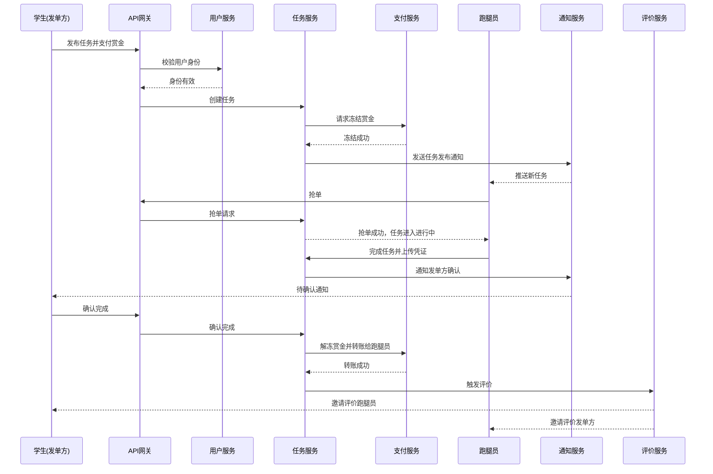

# 微服务实践课程仓库

- 课程：微服务架构
- 姓名：田漪婷
- 学号：2412190606
- 仓库用途：本仓库用于完成微服务课程的全部作业，包括需求分析、项目实现、测试、部署和文档整理。

## 项目概要

- **项目名称：** CampusRunner（校园跑腿服务平台）
- **项目简介：** 一个帮助大学生发布校园跑腿需求，并让有意愿的学生承接任务、获得兼职收入的平台。
- **业务背景：** 大学生经常需要代取快递、代买饭、代送文件，但缺少统一、可信的平台。
- **实际问题：** 需求信息分散在微信群中，接单效率较低，且缺少支付保障和信用评价机制。
- **目标用户：** 有跑腿需求的学生、希望兼职接单的跑腿员，以及负责平台运营的管理员。

主要用户需求：

- **发单：** 发布任务、支付赏金、查看任务进度、确认完成和评价。
- **接单：** 浏览并承接任务、上传任务进度或完成凭证、查看收益。
- **管理：** 审核任务、处理纠纷、管理用户和查看数据统计。

## 开发环境与运行要求

当前阶段的后端工程位于仓库根目录的 `monolith/` 中。

- **Java：** JDK 25
- **Spring Boot：** 4.0.8
- **构建工具：** Maven Wrapper（使用项目自带的 `mvnw` 脚本）
- **应用端口：** 8080
- **配置文件：** `monolith/src/main/resources/application.yml`

检查 Java 版本：

```bash
java -version
```

请确保命令输出的 Java 版本为 25。项目提供 Maven Wrapper，通常不需要另外安装 Maven。

## 项目结构

```text
.
├── README.md
├── docs/
│   └── project-proposal.md
└── monolith/
    ├── pom.xml
    ├── mvnw
    ├── mvnw.cmd
    └── src/
        ├── main/
        │   ├── java/
        │   └── resources/
        │       └── application.yml
        └── test/
            └── java/
```

## 启动与测试

以下命令均从仓库根目录执行。

### 启动应用

```bash
cd monolith
./mvnw spring-boot:run
```

应用启动后，默认监听 `http://localhost:8080`。请保持启动终端运行，再通过浏览器或 `curl` 访问接口。

Windows PowerShell 可在 `monolith/` 目录下运行：

```powershell
.\mvnw.cmd spring-boot:run
```

### 运行测试

在仓库根目录执行：

```bash
cd monolith
./mvnw test
```

测试通过时，Maven 应输出 `BUILD SUCCESS`。当前的 `MonolithApplicationTests` 使用 `@SpringBootTest` 和 `contextLoads` 测试方法，验证 Spring 应用上下文能够正常加载。

### 停止应用

在运行 `spring-boot:run` 的终端中按 `Ctrl + C`。

## 运行状态接口

### 问候接口

- **请求方法：** `GET`
- **访问地址：** `http://localhost:8080/api/hello`
- **用途：** 验证自定义 HTTP 接口可以正常访问。
- **预期响应正文：**

```text
CampusRunner is running!
```

使用 `curl` 验证：

```bash
curl -i http://localhost:8080/api/hello
```

### 跑腿任务列表

curl -i http://localhost:8080/api/tasks

任务列表以 JSON 数组形式返回；如果尚无任务，预期返回空数组 []。

### 健康检查接口

- **请求方法：** `GET`
- **访问地址：** `http://localhost:8080/actuator/health`
- **用途：** 检查 Spring Boot 应用健康状态。
- **预期结果：** 返回 JSON，且其中的 `status` 字段为 `UP`。

使用 `curl` 验证：

```bash
curl -i http://localhost:8080/actuator/health
```

当前配置会暴露 Actuator 的 `health` 和 `info` Web 端点。健康检查的详细响应可能包含磁盘空间等组件状态。

## 项目功能与总体目标

以下是 CampusRunner 的**整体规划目标**，并不代表这些功能已经在当前版本中实现。

- 完成校园跑腿最小业务闭环：注册登录 → 发布任务 → 抢单 → 创建订单 → 模拟支付 → 完成确认。
- 逐步进行微服务拆分：用户、任务、订单、支付、通知等服务，以及 API 网关。
- 完成服务治理：Nacos、Gateway、OpenFeign、LoadBalancer、Resilience4j。
- 探索分布式能力：RabbitMQ/Kafka、Seata/本地消息表、Redis 分布式锁。
- 完成可观测与部署：Zipkin、Prometheus、Grafana、Docker Compose。

### 适用场景

校园内代取快递、代买餐食、代送物品、代还图书等。适用于快递集中到达、天气恶劣、课程冲突、考试周等学生不便亲自处理事务的场景，也适用于校园内小团队或学生组织内部的互助跑腿场景。

### 主要用户角色及需求

| 角色 | 说明 | 主要需求 |
|---|---|---|
| 学生（发单方） | 有跑腿需求的学生 | 发布任务、支付、查看进度、确认完成、评价 |
| 跑腿员（接单方） | 愿意接单赚赏金的学生 | 浏览任务、抢单、上传凭证、查看收益 |
| 平台管理员 | 平台运营与管理人员 | 用户管理、任务审核、纠纷处理、数据统计 |

### 计划中的功能模块

- **用户模块：** 注册、登录、退出、校园认证（模拟）、个人信息管理、角色切换（发单/接单）、联系方式管理、信用分查询、收货/送达地址管理。
- **任务模块：** 发布任务、任务分类、设置赏金、任务大厅、搜索与筛选、任务详情、抢单/接单、任务状态流转、上传完成凭证、取消任务、任务超时处理。
- **订单模块：** 订单创建、订单状态管理、订单查询、订单详情、超时未支付取消、超时未确认自动确认、取消/退款记录、纠纷记录。
- **支付模块：** 模拟支付、模拟钱包、支付冻结、支付解冻、退款、交易流水、收益查询、提现（模拟）。
- **通知模块：** 站内信、任务状态变更通知、抢单通知、支付结果通知、超时提醒、系统公告、评价提醒。
- **评价模块：** 双向评价、评分、文字评价、评价列表、信用分计算、举报与申诉。
- **管理模块：** 用户管理、任务审核、分类管理、纠纷处理、数据统计、公告管理、信用体系管理、运营报表。

### 核心业务流程（规划）



## 当前实现状态

### 当前阶段已实现

- Spring Boot 工程初始化，工程位于 `monolith/`。
- 使用 Java 25、Spring Boot 4.0.8 和 Maven Wrapper。
- 使用 `application.yml` 配置应用名称、端口及 Actuator 端点。
- 提供 `GET /api/hello` 问候接口。
- 提供 `GET /actuator/health` 健康检查接口。
- 使用 `@SpringBootTest` 的 `contextLoads` 测试验证 Spring 应用上下文。
- 已运行 `./mvnw test`，并确认测试结果为 `BUILD SUCCESS`。

### 当前尚未实现的业务能力

当前版本主要用于验证工程能够启动、接口能够访问以及测试能够通过，**尚未实现 CampusRunner 的核心业务功能**，包括：

- 用户注册、登录、校园认证和角色管理。
- 跑腿任务发布、任务浏览、抢单及任务状态流转。
- 订单创建、订单管理和订单超时处理。
- 模拟支付、赏金冻结与解冻、退款和交易流水。
- 站内通知、任务状态通知和超时提醒。
- 双向评价、信用分计算、举报与申诉。
- 管理员后台、任务审核、纠纷处理和数据统计。
- 业务实体、Service、Repository、数据库持久化。
- 微服务拆分、API 网关、服务注册发现、消息队列、分布式事务和 Docker Compose 编排。

以上内容是后续迭代计划，不属于当前阶段的已交付功能。

## 暂不实现内容

- 真实第三方支付对接（微信/支付宝）。
- 真实短信、邮件、推送通知。
- 真实地图导航、定位、骑手轨迹。
- 跨校服务、多校区复杂调度。
- 复杂推荐算法、智能定价、风控模型。
- 高并发、海量数据下的性能优化。
- Kubernetes 生产级集群部署。

## 后续可扩展方向

- **服务拆分：** 从单体逐步拆分为用户服务、任务服务、订单服务、支付服务、通知服务、评价服务。
- **服务治理：** Nacos Discovery 服务注册发现、Nacos Config 配置中心、Spring Cloud Gateway 网关、LoadBalancer 负载均衡、OpenFeign 声明式调用、Resilience4j 断路器。
- **消息：** RabbitMQ / Kafka 实现异步通知、任务状态变更、超时延迟消息和服务解耦。
- **事务：** Seata 分布式事务，保证支付、订单、任务状态一致性。
- **缓存：** Redis 缓存热门任务、用户信用分，并通过分布式锁处理并发抢单。
- **监控：** Prometheus + Grafana + Micrometer Tracing + Zipkin，实现指标监控与链路追踪。
- **部署：** Docker Compose 本地编排，后续可扩展 Kubernetes、CI/CD、蓝绿部署。
- **安全：** API 网关鉴权、服务间加密通信、零信任架构、操作审计。

## 运行方式

### 启动单体应用

cd monolith
./mvnw spring-boot:run

### 验证接口

- GET http://localhost:8080/api/hello
- GET http://localhost:8080/actuator/health

默认端口为 8080。如需修改端口，可在 `monolith/src/main/resources/application.yml` 中调整 `server.port`。