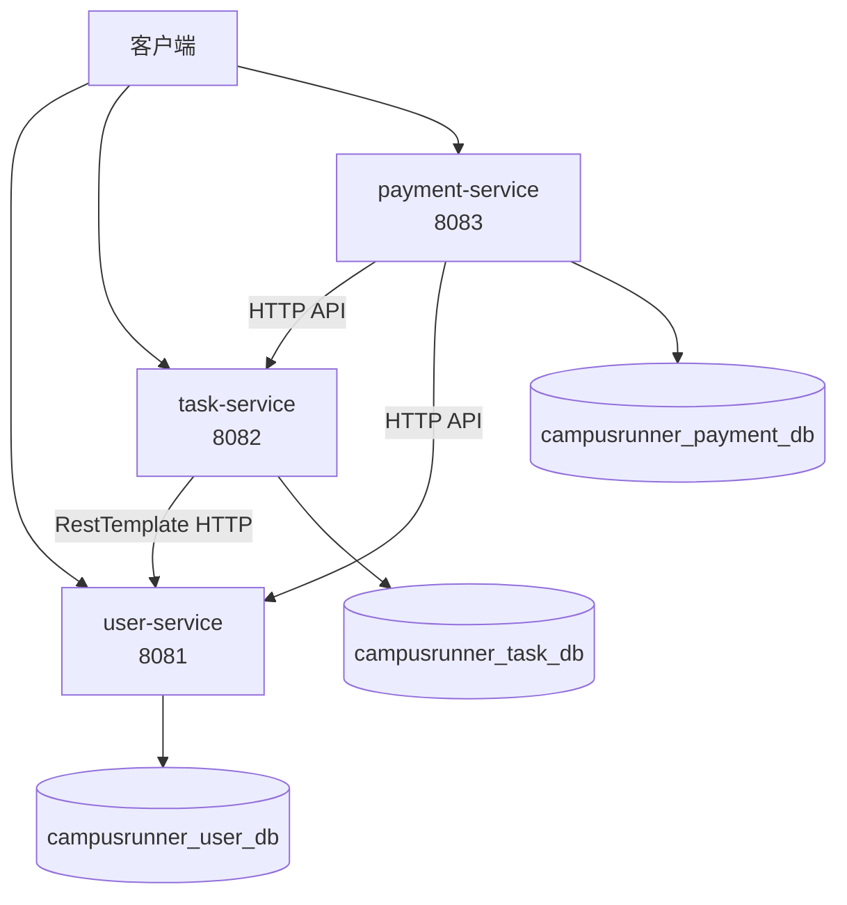

# CampusRunner 微服务拆分设计

## 1. 拆分目标

CampusRunner 当前采用 Spring Boot 单体架构，用户管理、跑腿任务管理和赏金支付等业务集中在一个工程中。为降低模块之间的耦合度，本次作业将系统拆分为三个独立的 Spring Boot 微服务，分别负责用户、任务和支付业务。

原有 `monolith/` 保留，不直接改名或覆盖。

## 2. 单体模块与微服务映射

| 单体业务模块 | 微服务 | 核心职责 |
|---|---|---|
| 用户管理 | user-service | 用户信息查询、用户角色管理 |
| 跑腿任务管理 | task-service | 发布任务、查询任务、领取任务 |
| 赏金与支付 | payment-service | 赏金冻结、支付记录、支付状态管理 |

## 3. 服务边界与数据归属

| 服务 | 端口 | 独立数据库 | 数据表 |
|---|---:|---|---|
| user-service | 8081 | campusrunner_user_db | users |
| task-service | 8082 | campusrunner_task_db | tasks |
| payment-service | 8083 | campusrunner_payment_db | payments |

### 3.1 user-service

负责用户信息及角色管理，对外提供用户查询 API。用户服务独占 `users` 表，其他服务需要验证用户时，通过 HTTP API 获取用户信息。

### 3.2 task-service

负责跑腿任务的创建、查询和领取。任务服务独占 `tasks` 表。任务记录保存发布者 ID 和接单者 ID，不通过跨数据库外键关联用户表。

领取任务时，任务服务通过 `RestTemplate` 调用 user-service，确认接单用户存在后再更新任务状态。

### 3.3 payment-service

负责赏金冻结、支付记录和支付状态管理，独占 `payments` 表。支付记录保存关联任务的 ID 和用户 ID，不直接访问任务服务或用户服务的数据库。

本阶段先建立独立工程和数据边界，支付相关业务根据后续实现逐步完善。

## 4. 服务调用关系

- 客户端通过 HTTP 请求访问对应服务。
- task-service 在领取任务前调用 user-service 查询接单用户。
- payment-service 通过 HTTP API 与任务服务或用户服务交换必要的业务信息。
- 各服务只能读写自己拥有的数据表。

## 5. Mermaid 架构图

## 6. 设计原则

1. 每个微服务是独立的 Maven / Spring Boot 工程。
2. 每个服务独立配置端口、数据库连接和测试。
3. 服务间通过 HTTP API 通信，不直接调用其他服务的 Repository。
4. 不建立跨数据库外键，跨服务关联只保存对方的业务 ID。
5. 使用 Docker Compose 统一启动服务和数据库，并使用健康接口及冒烟测试脚本验证部署结果。

## 7. 后续实施计划

1. 创建三个独立的 Spring Boot 工程。
2. 实现各服务的 Controller、Service、Repository 和测试。
3. 使用 RestTemplate 完成跨服务用户校验。
4. 配置独立数据库账号、数据卷和服务间网络。
5. 编写 `scripts/smoke-test.sh`，验证健康检查、业务成功和失败场景。